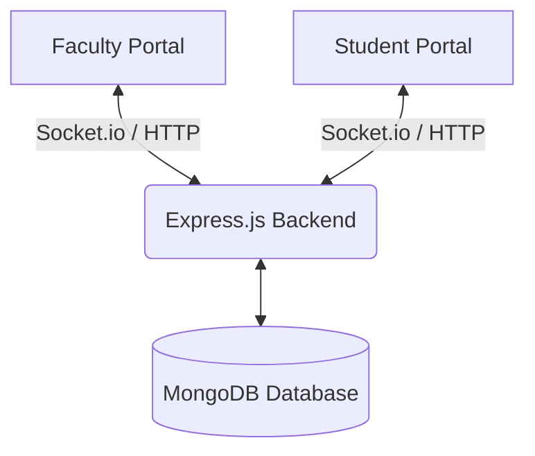
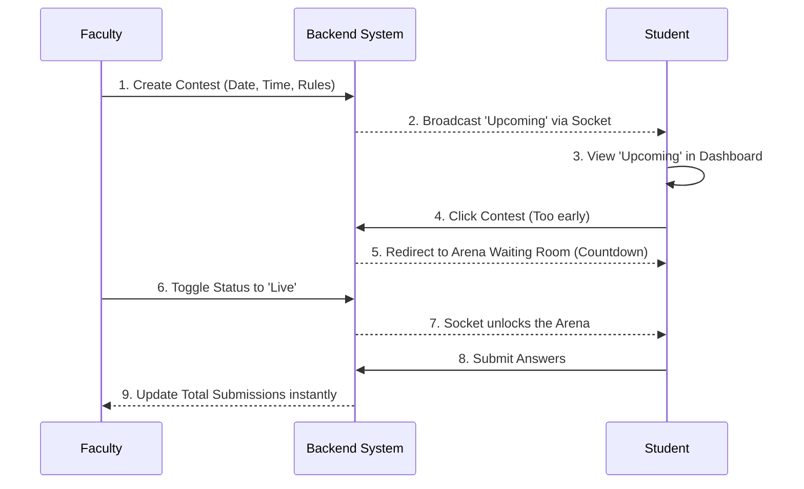

# 🎓 University Contest & Learning Platform

A comprehensive, dual-portal web application designed to bridge the gap between University Faculty and Students. It provides real-time contest management, course access, dynamic question banks, and live notice boards.

## 🌟 Key Features

### 👨‍🏫 Faculty Portal
- **Contest Manager & Question Bank**: Create, schedule, and manage MCQ or Coding contests. Leverage the global Question Bank to reuse questions or import bulk questions via document uploads (`.pdf`, `.docx`, `.txt`).
- **Live Monitoring**: Toggle contest statuses (Upcoming, Live, Ended) in real-time.
- **Notice Board**: Broadcast announcements and updates to specific batches instantly using WebSockets.
- **Student Records & Analytics**: Track student performance, average scores, and contest submissions with detailed modal views.
- **Course Hub**: Organize learning materials with modules, video lectures, notes, and assignments.

### 👨‍🎓 Student Portal
- **Live Arena**: Enter the waiting room for upcoming contests with a live countdown timer.
- **Real-Time Notices**: Instantly receive updates from mentors and faculty.
- **Course Hub**: Access enrolled courses, track progress, and review completed modules and lectures.
- **Premium UI**: Seamless Dark/Light mode optimized for prolonged usage with dynamic glassmorphic elements.

---

## 🏗️ System Architecture



## 🔄 Contest Flow Diagram



## 🛠️ Technology Stack
- **Frontend**: React.js, Vite, Tailwind CSS, Lucide Icons, React Router DOM.
- **Backend**: Node.js, Express.js, MongoDB (Mongoose).
- **Real-Time Communication**: Socket.io.
- **Document Parsing**: Mammoth (`.docx`), pdf-parse (`.pdf`) for bulk question uploads.
- **Styling**: Custom Tailwind CSS (Premium Dark Mode with Glassmorphism).

## 🚀 Installation & Setup

1. **Clone the repository**
   ```bash
   git clone https://github.com/Aditisingh0102/yourCONTEST.git
   cd yourCONTEST
   ```

2. **Environment Setup**
   Create a `.env` file in the `backend/` directory for your environment variables (e.g., `PORT`, `MONGO_URI`).

3. **Start the Backend Server**
   ```bash
   cd backend
   npm install
   npm run dev
   ```

4. **Start the Frontend Application**
   ```bash
   cd frontend
   npm install
   npm run dev
   ```

5. **Access the platform**
   Open your browser and navigate to `http://localhost:5173`.
